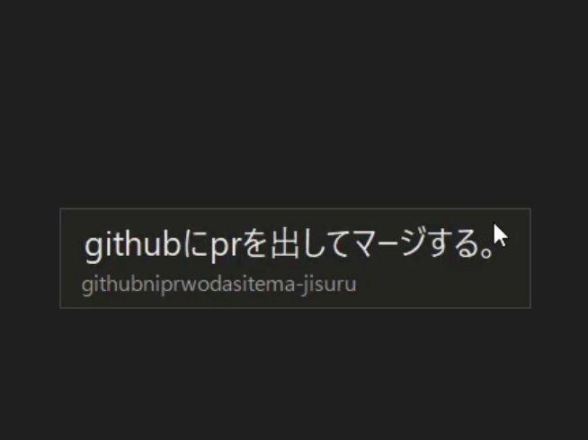

# romaji-slm

ローマ字の打鍵を、文脈を見て日本語に変換する入力システムです。小さな言語モデルを手元の PC だけで動かします。



`githubniprwodasitema-jisuru` と打つと「githubにprを出してマージする。」になります。英単語の混じった文や、多少の打ち間違いもそのまま変換します。

## 仕組み

学習はしていません。既存の部品を組み合わせて、変換の候補をしぼってから言語モデルに選ばせます。

1. **読みの候補を作る**：打鍵列から、ローマ字の揺れ（`si` / `shi`）、打ち間違い、英単語、数字・記号を考えた読みの候補を作る
2. **表記の候補にしぼる**：Mozc の辞書で、読みに合う表記だけを残す
3. **言語モデルで選ぶ**：凍結した日本語かな漢字変換モデル [zenz-v3.1-small](https://huggingface.co/Miwa-Keita/zenz-v3.1-small) が、文として自然な候補に高い点を付ける

モデルを微調整する案も試しましたが、既存のベンチマーク（AJIMEE）で精度が 87% から 28.5% に落ちたので採りませんでした。

## 結果

| 評価セット | 件数 | 完全一致 |
|---|---|---|
| 作者の文体の作例（user_style） | 73文 | 82.2% |
| [AJIMEE-Bench](https://github.com/ensan-hcl/AJIMEE-Bench) | 200件 | 84.5% |
| 生成したテスト文（gen_test） | 337件 | 34.1% |

1文の変換にかかる時間（中央値）は、GPU で 249ms、CPU で 552ms でした（常駐入力を模した30文、RTX 5060 Ti / Core Ultra 5 245KF、2026-10）。

## 試す

Python 3.12 以上と [uv](https://docs.astral.sh/uv/) が必要です。Windows で開発しています。

```bash
git clone https://github.com/morikawa976321/romaji-slm.git
cd romaji-slm
uv sync --all-groups
uv run --group core python -m core.fetch_mozc   # Mozc 辞書を取得（初回だけ）
uv run python -m trial.server --open            # ブラウザで変換を試すページを開く
```

モデル（zenz）は初回に Hugging Face から自動で取得します。GPU（CUDA）があれば torch で、無ければ ONNX Runtime で CPU 上で動きます。

画面だけ見たいときは `uv run python -m trial.server --mock --open` で、モデル無しの偽の変換で開けます。

**常駐入力**：Windows 全体で使えるキーフック版もあります（Ctrl+Alt+Space で切り替え）。管理者権限のウィンドウなど、効かない場所があります。手順は [docs/IME.md](docs/IME.md)。

## 状態

作者が自分の PC で毎日使いながら直しています。1語に3つ以上の打ち間違いがある入力、句読点の自動挿入はまだ苦手です。

## 文書

- [docs/REDESIGN.md](docs/REDESIGN.md) — 方式の決定と先行例
- [docs/EVAL.md](docs/EVAL.md) — 評価の方法と結果
- [docs/SPEEDUP.md](docs/SPEEDUP.md) — 速くするためにしたこと
- [docs/DEVELOPMENT.md](docs/DEVELOPMENT.md) — 開発の経緯と、ほかの文書の一覧

## ライセンスと出典

このリポジトリのコードは [MIT](LICENSE) です。

使っている外部の資源と、そのライセンス：

| 資源 | ライセンス |
|---|---|
| zenz の重み（実行時に取得） | CC BY-SA 4.0 |
| Mozc の辞書（実行時に取得） | BSD-3-Clause |
| AJIMEE-Bench（評価時に取得） | データ CC BY-SA 3.0、コード CC0 |

`data/samples/sample_200.jsonl` は、[Miwa-Keita/zenz-v2.5-dataset](https://huggingface.co/datasets/Miwa-Keita/zenz-v2.5-dataset)（Miwa Keita）の文を元に、ローマ字化・打鍵ミスの付与・読みの付け直しを加えて作った 200 件で、元データのライセンス（大半は CC BY-SA 4.0、llm-jp-corpus v3 由来の部分は ODC-BY）に従います。
